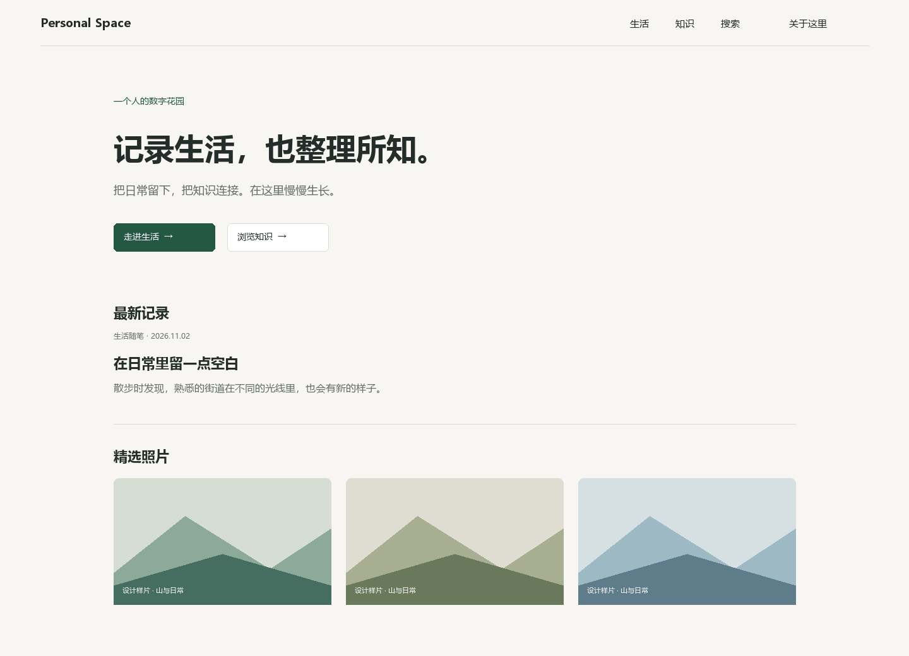

# Personal Space

Personal Space 是一个自托管的个人网站，用来整理生活记录、知识笔记和照片。站主可以在后台写作、管理图片和组织专题，再选择哪些内容公开。访客无需注册，就能浏览、搜索和阅读已发布的内容。

## 你可以用它做什么

- **写文章、记生活**：用 Markdown 编辑文章和短记。草稿可以反复修改，确认发布后才会更新访客看到的版本。
- **整理笔记和专题**：用分类和标签整理内容，用中文搜索找回旧文章，或把分散的文章、记录和相册收进同一个兴趣专题。
- **分享相册**：从媒体库选照片、调整顺序和填写说明。访客可以在相册里打开大图浏览。
- **管理自己的内容**：站主通过双因素认证登录后台，可查看历史版本、从回收站恢复内容，并导出或备份站点数据。配置摘要服务后，编辑器可按需生成文章摘要建议。

## 页面预览



*桌面首页设计原型。更多桌面和手机页面见[页面原型目录](docs/design-delivery/04-页面原型)。*

## 本地运行

需要 Node.js 24（至少 24.21.0）、npm 11 和 Docker。首次搭建请按[本机运行说明](docs/OPERATIONS.md)准备隔离数据库、对象存储和管理员测试账号。已有隔离环境可用以下命令启动：

```powershell
node integration/setup-local.mjs
npm run build
node integration/run.mjs web-production
```

启动后打开 [网站首页](http://127.0.0.1:3000) 或 [管理后台](http://127.0.0.1:3000/admin)。

## 技术与进度

应用使用 Next.js、React 和 TypeScript，数据保存在 PostgreSQL，通过 Prisma 访问。图片使用 S3 兼容对象存储，备份使用 pg_dump 和 restic。

项目正在进行首发验收，尚未部署生产。内容发布、兴趣专题和 AI 摘要已在本地完成端到端验证。AI 摘要验收使用本地测试服务。

- [技术架构](docs/ARCHITECTURE.md)
- [部署手册](docs/DEPLOYMENT.md)
- [首发验收记录](docs/verification/2026-11-12-first-release.md)
