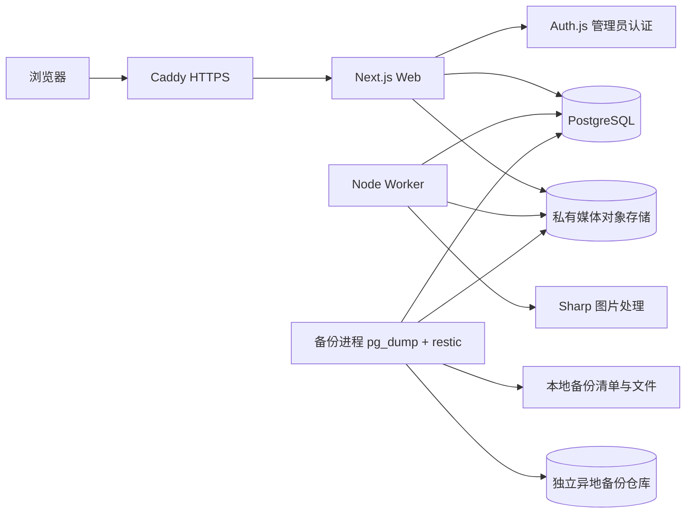

# Personal Space V1.0 技术方案与架构决策

版本 ADR-1.0 · 2026-11-02 · 状态：技术路线定案，工程验证尚未完成。

实现进展更新：后续N2批次已补齐29个模型、引用同步与公开版本独立查询；本文件第10节保留选型时的代码核对快照，最新完成状态及仍待验证事项以[IMPLEMENTATION.md](IMPLEMENTATION.md)和[N2记录](verification/2026-11-02-data-layer.md)为准。

本文件承接冻结的产品与数据语义，补齐实现方案。它不将既有示例页面、测试或可构建代码视为完整 V1.0。原五份冻结资料位于 design-delivery，本文件不会覆盖原始交付包。

## 1. 最终选择

采用**模块化单体 + 独立后台执行进程**。Web 与 Worker 使用同一个仓库、同一套领域模型和 PostgreSQL；慢任务由 Worker 执行。单管理员规模下，先保持单 Web 实例、单 Worker；不引入微服务、Redis 或独立搜索服务器。

| 层次 | 选定技术 | 用途与边界 |
|---|---|---|
| 运行时 | Node.js 24；当前工程基线24.21.0 | Web与Worker均为Node运行时，不使用Edge运行时执行数据库、图片或备份操作 |
| 应用 | Next.js 16.4.4、React 19.3.1、TypeScript 5.9.3 | App Router页面、服务端读取、客户端编辑交互、REST Route Handlers；不另建Express/Nest后端 |
| 样式与正文 | 原生CSS、react-markdown 10.1.0、remark-gfm 4.0.1 | 响应式页面、Markdown阅读；不允许任意HTML或不受控图片URL直通 |
| 数据校验 | Zod 4.6.7 + OpenAPI 3.1.1 | 请求结构与业务条件分层校验；Zod不是数据库约束的替代品 |
| 数据库 | PostgreSQL 18主版本 | 事务、内容版本、引用、路由、搜索、持久化任务；补丁版本在实际安装前锁定 |
| 数据访问 | Prisma Client/adapter-pg 7.10.1 + pg 8.23.1 | 一般查询使用Prisma；高级约束、锁、搜索使用经审查的参数化SQL |
| 管理员认证 | next-auth **4.24.15稳定版**（Auth.js体系） | Credentials + JWT会话 + 服务端session_version检查；不设第二套业务登录 |
| 密码/MFA | @node-rs/argon2 2.2.2；TOTP拟接入otplib 13.6.0 | Argon2id密码/恢复码哈希，TOTP密钥AES-256-GCM加密；现有手写TOTP待库化替换与测试 |
| 媒体 | 私有S3兼容对象存储 + AWS SDK for JavaScript v3 | 服务端流式读写，不公开原图bucket/key；供应商、地域、桶名属于部署参数 |
| 图片处理 | Sharp 0.35.5 | 受限解码、校正方向、缩放、WebP派生、清除敏感元数据；原图保持不可变 |
| 后台任务 | PostgreSQL operation_jobs/outbox + 独立Node Worker | 行级抢占、SKIP LOCKED、租约、fencing token、幂等消费；应用表是业务状态来源 |
| 搜索 | PostgreSQL公开搜索投影 + pg_trgm | 长词三元组辅助匹配，1–2字单独处理，实时权限过滤 |
| 备份 | PostgreSQL 18的pg_dump/pg_restore + restic 0.19.1 | 数据库一致性快照、必要媒体清单、加密异地副本、恢复演练 |
| 目标运行环境 | Linux x86_64，Docker Compose，Caddy 2 | Web/Worker/Postgres分进程或容器；Caddy反代及HTTPS。Windows作为当前开发环境 |
| 测试 | node:test + tsx；后续真实PG集成及浏览器验收 | 领域、契约、数据库并发、安全、真实页面分别收集证据 |

表中Sharp、otplib、S3 SDK、Worker、备份工具及容器是**选定的后续实现方案**，本次没有安装或运行它们。其依赖安装时应精确锁定版本，并复核当时安全公告。Caddy/PostgreSQL镜像最终补丁及digest在准备实际运行环境时锁定，不能以浮动latest发布。

## 2. 系统边界

图为目标结构，不表示上述服务已经创建。Web不能对外开放数据库端口；浏览器不直连数据库或对象存储。Worker与Web使用不同的最小权限凭据，备份进程使用独立数据库/存储权限及密钥。

服务端页面直接调用应用查询服务，避免服务器绕HTTP再请求自己；外部客户端和交互写入使用/api/v1。两条入口复用同一权限谓词和应用服务，不能各自实现一套发布逻辑。路由层只负责鉴权、输入、状态码和序列化；领域层定义生命周期；基础设施层负责事务、对象存储及任务。

## 3. ADR-01：认证选择与版本收敛

保留Auth.js体系，将首批代码中的5.0.0-beta.32替换为4.24.15稳定版。已核对npm官方包元数据：4.24.15的peerDependencies包含Next.js 16和React 19；并读取其发布包next/index.js，确认Route Handler与getServerSession对params、cookies、headers使用异步读取。随后通过类型检查、构建及本地提供方路由检查，不能只凭“稳定”两个字认定兼容。

稳定版通过getServerSession(authOptions)读取服务端会话，业务侧继续使用auth()包装函数。AUTH_URL是项目唯一规范源地址，映射给提供方NEXTAUTH_URL；AUTH_SECRET显式传给提供方，避免部署时维护两套相互矛盾的配置。cookie在开发与HTTPS下的实际前缀由提供方负责，业务不得硬编码读取cookie。

JWT为8小时会话；每次管理读取/写入都再次查询管理员MFA状态及session_version。退出、密码/MFA变更、恢复码重置时应撤销相关会话；单管理员初始化必须受控，不开放注册。采用JWT会话是Credentials路线的明确选择，**不再列一个尚未选定的数据库会话adapter作为待决分支**；管理员、恢复码、重认证及防重放记录仍需在数据库中存储。

业务写入验证同源Origin与会话相关CSRF证明；Auth.js提供方登录/退出使用其自身CSRF流程。敏感操作的重新认证证明应绑定adminId、session标识、允许的operation、有效期和一次性消费状态；建议5分钟、单次使用。不得把第二次验证变成独立登录会话，也不得对外开放普通“设置PUBLIC”接口绕过发布确认。

TOTP认证保留30秒时间步、最多±1步容差及数据库last_totp_step原子消费；恢复码哈希与used_at条件更新保证单次消费。下一批用otplib替代手写计算，保留已知向量、防重放及错误时间边界测试。密码与恢复码初始化使用Argon2id，初始参数至少19MiB内存、2次迭代、并行度1；须在真实服务器测量延迟并核对当前建议，不能存明文。[密码存储依据](https://cheatsheetseries.owasp.org/cheatsheets/Password_Storage_Cheat_Sheet.html)

本次认证验证只涵盖提供方发现、CSRF、错误凭据拒绝、无会话及匿名拒绝。真实账号首次绑定、成功登录、过期、撤销、恢复和重认证仍属于IV-01，未通过前不得公网使用。[会话API依据](https://next-auth.js.org/configuration/nextjs)

## 4. ADR-02：数据与事务

PostgreSQL是内容与状态的唯一持久真相。保留contents身份、content_drafts工作副本、content_revisions不可变快照、published_revision_id唯一正式指针，以及由快照生成的查询投影。原冻结的D-01～D-06和三种编号均不改。

完整约束不能交给Prisma自动推断。必须有单管理员CHECK、组合FK、根分类NULL唯一、两级分类防环、单canonical部分唯一、快照/历史引用不可改删权限、状态/枚举约束及媒体引用保护。Schema文件只负责可表达部分，后续经授权生成的迁移再承载PostgreSQL高级机制；本次没有迁移。

目标锁序为contents→draft→分类标签按ID→media按ID→routes；保存和发布均在事务内重新检查条件。版本号在内容锁下分配；发布写入快照、历史引用、主指针、当前投影、路由、搜索、outbox、审计和幂等结果，同一事务提交。对象存储操作不伪装成数据库事务，失败通过持久化任务恢复。

首批代码的全局advisory lock可暂时保护唯一管理员的文本变更，定位为过渡实现。补齐引用表后改为按内容行锁，以免长任务阻塞所有写作；跨内容路径由全局唯一索引兜底，死锁和serialization失败只做有界、可重放重试。不要在发布事务内上传图片、跑Sharp或制作备份。

公开查询仅取当前快照及必要投影，不应加载草稿和全部历史再过滤。所有公开路径（列表、详情、搜索、别名、图片）实时检查PUBLISHED/PUBLIC/未删除和当前指针。公开详情应按ID或path直接查单项，分页和筛选在数据库内完成。

## 5. ADR-03：媒体与对象存储

选择私有S3兼容接口，应用通过AWS SDK v3的流式GetObject/PutObject访问。开发测试使用显式的临时文件适配器，不把本地目录作为生产原图库；不自动安装或创建MinIO。媒体桶与异地备份仓库分开管理，备份账号、删除权限和故障域分离。供应商、endpoint、region和配额由实际账户决定，不需要因此重写媒体业务。[SDK依据](https://docs.aws.amazon.com/sdk-for-javascript/v3/developer-guide/javascript_s3_code_examples.html)

图片原图以UUID/摘要构造不可变key，不能用上传文件名做路径。上传流先检验大小、魔数和像素，建立UPLOADING/PROCESSING记录及任务，响应202；Worker用Sharp解码、纠正方向、生成THUMBNAIL/DISPLAY，校验完成再标READY。默认不保留EXIF/XMP/IPTC，明确禁止调用keepMetadata/withMetadata；必须对实际产物检查定位字段，而不是仅依赖函数名。[Sharp依据](https://sharp.pixelplumbing.com/api-output/)

初始工程默认值：JPEG/PNG/WebP，单图10MiB、24百万像素，暂不接收SVG/动图；缩略图长边480、展示图长边2560，WebP质量82，不放大小图。以上为本轮新增的可配置默认，不冒称旧产品基线已确认；受限资源环境需调低并更新验收边界。Sharp每进程并发1，测试超大图的内存峰值后再决定资源限额。

公开图像请求必须带contentId+placementId+variant，并核对当前快照与有效权限，之后由Web服务端流式返回。原图仅管理员可读；不返回原图bucket/key，不发会在撤销权限后继续生效的直链或长期签名URL。正文中的media://placementId只能解析到受控媒体路径。首版保守private,no-store；未来缓存优化必须重新通过撤销权限测试。

草稿、历史、当前发布三层引用都保留placementId、说明、altText和顺序；同一mediaId可重复。GC只处理无所有引用且经过宽限期的对象；活跃备份期间禁止清理其清单对象。媒体上传成功、处理成功、被发布是三个不同事件。

## 6. ADR-04：后台任务

选择与冻结表一致的PostgreSQL任务机制：operation_jobs为任务状态来源，outbox_events保存事务提交后的动作。Worker轮询并用FOR UPDATE SKIP LOCKED认领，提交短事务后才执行外部I/O；不能持行锁处理整张图片或备份。SKIP LOCKED仅用于队列竞争，不用于内容读取。[PostgreSQL锁依据](https://www.postgresql.org/docs/18/sql-select.html)

认领时写lease_token、lease_until和attempts；心跳续租，完成或失败的更新必须同时匹配id与lease_token。租约过期可重新认领，旧执行器结果无权覆盖新结果。外部对象key及消费记录按job/event标识去重，接受至少一次投递；不承诺数据库以外副作用的“恰好一次”。

初始默认并行任务1，心跳10秒、租约60秒，最多3次执行，失败间隔30秒/120秒；达到上限后FAILED并保留错误摘要。媒体与备份可按类型分别设置超时，长任务持续心跳。调度按Asia/Hong_Kong生成唯一计划键，Worker停机后补齐漏掉的一次计划，不重复建立相同备份任务。

本轮比较过pg-boss和Redis/BullMQ：前者会增加一套内部队列状态和映射，后者还增加独立服务；当前冻结表已具备租约和恢复字段，因此V1采用上述机制。它的代价是必须完成租约、防重与故障注入测试，不能以“代码少”省略IV-06。

## 7. ADR-05：中文搜索

索引源为content_search_documents，字段由当前快照生成。发布同步更新，转私密/撤回/删除同步清除；所有查询仍JOIN contents实时权限及revision指针，投影不是授权凭据。

关键词NFKC标准化并去首尾空白；1–2字走单独的转义字面包含匹配，不能指望trigram索引覆盖。较长词使用pg_trgm GIN辅助包含与相似度查询；分类、标签及标题/摘要/正文共同参与。不得用simple分词器的默认tsvector冒称已经解决中文分词。[pg_trgm依据](https://www.postgresql.org/docs/18/pgtrgm.html)

相关性优先标题，其次摘要、分类标签、正文；最终排序键为整数化相关分、发布时间DESC、ID DESC，游标签名绑定完整筛选及排序版本。短词不得静默截断成前N条后再假装完整；若超出2秒的初始statement_timeout，返回明确的可重试失败，待IV-03根据数据集调整。现有JavaScript全量匹配仅用于首批示例，不是最终查询方案。

## 8. ADR-06：备份与恢复

选择pg_dump自定义格式 + 必要媒体清单 + restic加密异地仓库。适用于本项目单管理员、每日备份的初始目标；当前不承诺分钟级RPO，也不把逻辑导出当作所有生产场景的通用备份。若业务要求更短RPO，再另立WAL/PITR架构变更。[pg_dump依据](https://www.postgresql.org/docs/18/app-pgdump.html)

一致性流程：建立备份任务与GC保护租约；只读REPEATABLE READ事务导出数据库snapshot，并在同一snapshot读取必要媒体key/版本/校验和；pg_dump使用该snapshot；复制清单所指的不可变对象到本地staging；核对dump、对象和manifest；释放snapshot/保护租约；将完整bundle上传到独立restic仓库。数据库snapshot不能冻结对象存储，正确性依赖不可变key和GC保护，不能只顺序执行“导出数据库、复制当前桶”就宣称一致。

manifest记录schema版本、数据库snapshot/工具版本、对象清单和SHA256、备份ID、时间及必要恢复参数，不含明文密钥。数据库dump需要匹配PostgreSQL18工具；恢复还包括角色/权限、扩展及独立保管的密钥材料，不能假设pg_dump包含所有集群全局配置。

初始调度与保留**建议值**：每日03:00（香港时间）；日7份、周4份、月12份、年3份；手动备份不随自动清理。RPO目标≤24小时、RTO目标≤4小时。它们是本轮技术建议，尚未获用户对实际存储成本/恢复目标的确认，也未用实测证明；不启用调度/自动删除，部署准备时单独确认并据演练调整。

local_status、integrity_status、offsite_status独立推进。restic上传成功只代表存在snapshot，默认check不等于读取并校验全部备份数据；使用read-data全量校验才能证明实际数据检查，并记录校验范围/时间。首次上线前全量校验和完整隔离恢复必须通过；以后计划定期全量检查，不能把抽样检查标成全量。全量读取的时长和流量需要在实际仓库评估。[restic检查依据](https://restic.readthedocs.io/en/stable/045_working_with_repos.html)

完整恢复演练覆盖草稿、历史、主指针、路由、标签、原图/派生、私密权限、管理员/MFA恢复及校验和。每季度与首次公网前执行；校验文件或列出dump目录都不能代替恢复演练。

## 9. ADR-07：目标运行方式与密钥

目标为Linux x86_64、Docker Compose管理的web/worker/postgres/caddy；数据库和对象访问走私网或TLS。只公开Caddy的HTTP/HTTPS入口。Caddy自动签发/续期需满足域名解析、端口与持久化数据目录条件，不能在无域名时声称HTTPS已完成。[Caddy依据](https://caddyserver.com/docs/automatic-https)

当前Windows只用于开发；Sharp/Argon2原生模块还需在目标Linux构建与运行。实际服务器CPU、内存、磁盘、系统和既有服务未知，不承诺现有云服务器足够；在准备运行环境时测量Web/Worker峰值、连接池及备份空间，不据想象给采购结论。初始连接池预算Web≤5、Worker≤2，额外计入备份/维护连接；资源上限通过实测落定。

密钥分离：AUTH_SECRET、游标签名密钥、TOTP加密key、重认证签名key、媒体凭据、异地备份凭据/restic密码。密钥来自未跟踪的环境文件或只读secret挂载，不写普通system_settings；备份加密材料须有独立离线恢复副本。轮换、密钥丢失与MFA恢复都要进演练。当前代码复用AUTH_SECRET签游标属于过渡实现，后续拆分并给旧游标返回明确失效。

健康检查分live/ready：ready检查必要配置、数据库及所需扩展/Schema版本；业务未就绪返回503且不暴露细节。结构化日志使用requestId/jobId、耗时和错误code，不记录密码、验证码、恢复码、正文或带授权信息的URL。审计留在数据库；监控覆盖任务积压、备份年龄与三项结果、存储失败及异常认证。当前未运行上述监控服务。

## 10. 现有代码核对与处理

| 编号 | 现状与证据 | 决策 | 门槛 |
|---|---|---|---|
| C-01 | 页面与领域逻辑已分离，domain.ts及18项测试覆盖核心生命周期 | 保留页面、样式、状态机和测试；按后续数据层接入，不重写全部前端 | 真实设备与48项验收仍需完成 |
| C-02 | 首批next-auth v5为beta | 本次已改4.24.15，采用稳定API并通过提供方/CSRF/拒绝路径验证 | 成功登录/MFA/撤销还待真实账号测试 |
| C-03 | schema.prisma缺引用/任务/备份等表和高级约束 | 补齐完整物理模型及约束映射后才允许准备迁移 | 连接真实库之前阻断 |
| C-04 | content-store.ts公开读取include草稿、所有revisions/routes，再构造白名单 | 改为最小公开查询与按ID/path直查；目前没有据此确认前台泄漏，但数据边界不应依赖最后一步裁剪 | 真实内容接入前修正 |
| C-05 | 公开搜索、分页和后台筛选主要在内存做，部分目录固定空 | 改为数据库查询服务与公开搜索投影；空目录不能作为完整分类实现 | 功能验收前修正 |
| C-06 | 全局advisory lock、Prisma数据层与路由混合了部分持久化职责 | 依既定锁序改内容行锁，补outbox、引用同步与故障注入；全局锁只保留必要的初始化/维护用途 | 发布事务联调前修正 |
| C-07 | crypto.ts手写TOTP；缺首次账号绑定与重认证流程 | 库化TOTP、受控初始化、恢复与单次重认证；保留AES-GCM和原子消费语义 | 公网前安全阻断 |
| C-08 | 503与两个新错误code已出现在实现，冻结YAML未列 | 维护工作契约contracts/openapi.yaml并记录技术修订；冻结原稿不覆盖 | 契约联调前一致 |
| C-09 | 媒体/分类暂拒绝写入；任务/导出/备份尚未实现 | 按ADR-03/04/06接入，继续拒绝未完成副作用，不伪报成功 | 完整V1验收阻断 |
| C-10 | 直接依赖含范围号，已有lockfile | 本次把直接依赖固定到已安装的精确版本，统一npm ci；记录升级变更 | 已落实，不代表未来不更新补丁 |

以上是对现有项目的实现核对；不等于上述所有修正本次都已编码。除C-02/C-10及工作契约修订外，其余按下一节计划落实。

## 11. 后续开发顺序与退出条件

1. **数据闭环**：补全所有模型/引用/高级约束定义、最小公开查询、事务服务与活跃契约；代码和静态检查先完成，不建库。
2. **受控本地联调**：另获建库/迁移授权后，在隔离PostgreSQL18中运行约束/并发/失败回滚；完成唯一管理员、MFA与恢复初始化，不写死默认账号。
3. **媒体与分类**：S3适配器、Sharp Worker、引用和删除保护、两级分类/标签、排序/恢复；检查原图与缓存撤销。
4. **搜索与任务**：中文投影、数据库筛选/分页、短词计划；Worker租约/重认领/outbox去重，完成IV-03/06证据。
5. **导出与保护**：导出、分级备份、异地校验、密钥恢复与完整演练；确认实际保留/容量/RPO/RTO。
6. **上线前验收**：48条用例、真实设备/无障碍、安全及Linux容器验证通过后，再按用户指令准备部署。当前不得跳至这一步。

这份方案锁定的是工具、职责与数据流。供应商账户、域名、服务器地址、桶名、密钥及实测资源上限属于运行配置；它们的缺失不再导致架构A/B反复选择。任何改变内容权限、版本、路由或恢复语义的决定仍需更新五份冻结资料及对应验收。

## 12. 本次来源与验证范围

已读取12份官方资料，URL及SHA256记录在architecture/sources.json；npm元数据与next-auth发布源码另有证据记录。资料仅用于选型，不代表外部工具已安装或服务已创建。

本次保留原18项逻辑测试并通过；稳定版认证路由兼容检查和原16项本地只读检查通过，类型及生产构建通过。没有真实数据库、账号、MFA绑定、对象存储、备份或部署。IV-01～08仍以实现和运行证据关闭，不能由架构文档代替。
